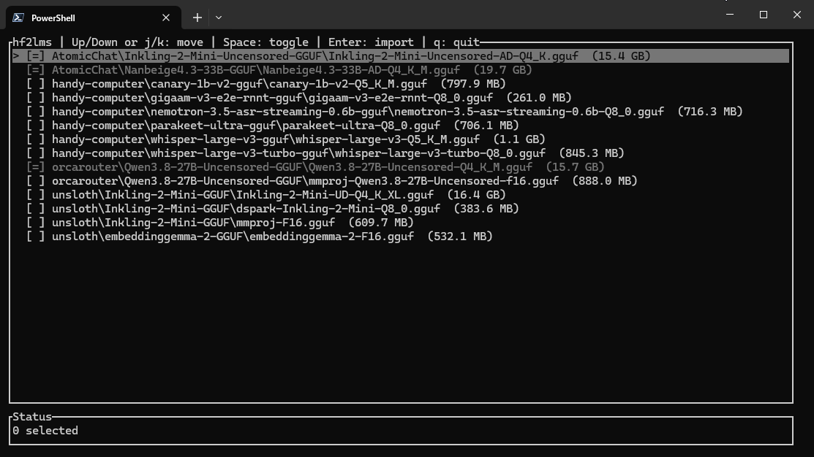

# hf2lms



An interactive terminal UI (TUI) built in Rust that scans a Hugging Face cache for `.gguf` models and hard-links them into an LM Studio models directory without duplicating large weight files.

## Usage

```text
hf2lms [OPTIONS]

  -h, --help           Show help and exit
  -f, --force          Allow overwriting conflicting files
      --hf <PATH>     HF cache 'hub' folder for this run
      --lms <PATH>    LM Studio models folder for this run
```

On first run both paths are asked interactively and saved to a config file. `--hf` and `--lms` override the saved paths for one run only.

## What It Does

- **Discovers GGUF models:** scans `<hf_cache>/models--<org>--<model>/snapshots/*` for `.gguf` files, resolves symlinks to the real blobs, picks the revision from `refs/main` (falling back to the newest snapshot), and skips empty files.
- **Detects existing links:** uses `same_file::is_same_file` to compare file identity, so already-linked models are skipped. An existing file that is not the same file is reported as a conflict.
- **Organizes by `<org>/<model>`:** links into `<lms_dir>/<org>/<model>/<filename>.gguf`, creating target directories automatically.
- **Hard-links without extra disk usage:** uses `std::fs::hard_link` instead of copying multi-gigabyte files.
- **Interactive keyboard navigation:** browse, multi-select, then import the selected models.

## Config file

Paths are stored in JSON:

- Windows: `%APPDATA%\hf2lms\config.json`
- Linux/other Unix: `$XDG_CONFIG_HOME/hf2lms/config.json`, or `~/.config/hf2lms/config.json`
- Set `HF2LMS_CONFIG` to use an explicit file path instead.

The config lives in the user config directory, not next to the binary: `cargo install` may place the binary somewhere the user cannot write to (for example a system-wide install). If no standard location can be resolved, the executable's directory is used as a last resort.

## Controls

- `Up` / `Down` or `j` / `k` — navigate the model list
- `Space` — toggle selection (conflicts require `--force`)
- `Enter` — create directories and hard-link selected models
- `q` / `Esc` — quit without making changes

`[=]` means already linked, `[!]` means a conflicting file exists, `[x]`/`[ ]` means selected/not selected.

## Notes & Current Limitations

- Hard links require the source and destination to be on the same filesystem/volume.
- `--force` removes a conflicting target file before creating the link; if the link fails afterwards, the old file is not restored.
- Models whose target paths collide are deduplicated; the winner depends on directory iteration order.
